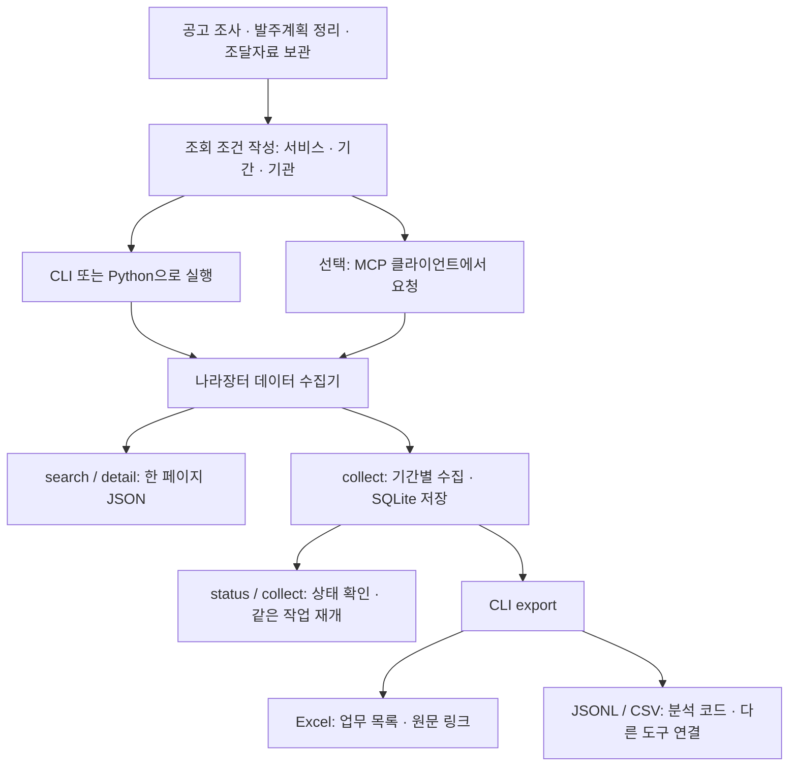
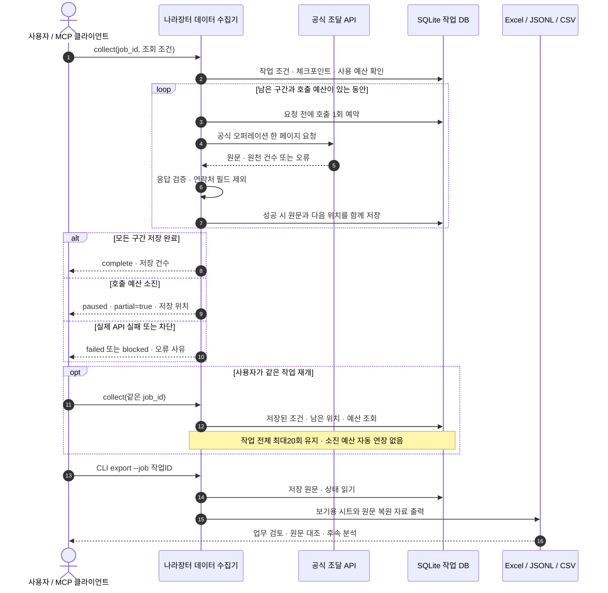

# 나라장터 데이터 수집기 — 개발자용 상세 흐름

[처음 사용하는 분을 위한 안내](../README.md#한눈에-보는-사용-흐름)에서는 네 단계로 사용 방법을 설명합니다. 아래 도표는 코드를 연결하거나 수정할 때 참고하는 처리 순서입니다.

## 한눈에 보는 사용 흐름

공고 조사·기관 발주계획 정리·기간별 자료 보관을 같은 도구로 처리합니다. 검색 결과는 JSON으로 읽고, 저장한 작업은 CLI로 Excel·CSV·JSONL을 내보냅니다.

### 수집·재개·Excel 저장 순서

실패 작업은 원인을 해결한 뒤 `retry_failed`를 명시해야 합니다. `complete`도 수집 도중 원천이 변하지 않았다는 보증은 아닙니다. MCP는 검색·수집·상태 도구를 제공하며 파일 내보내기는 CLI 또는 Python API를 사용합니다. [시나리오별 활용](recipes.md)에서 실행 명령을 확인하세요.

